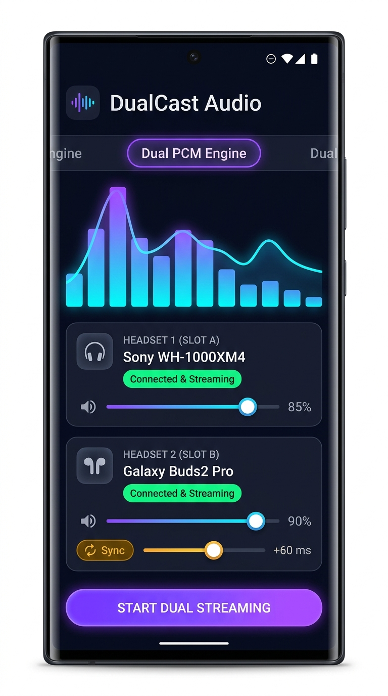
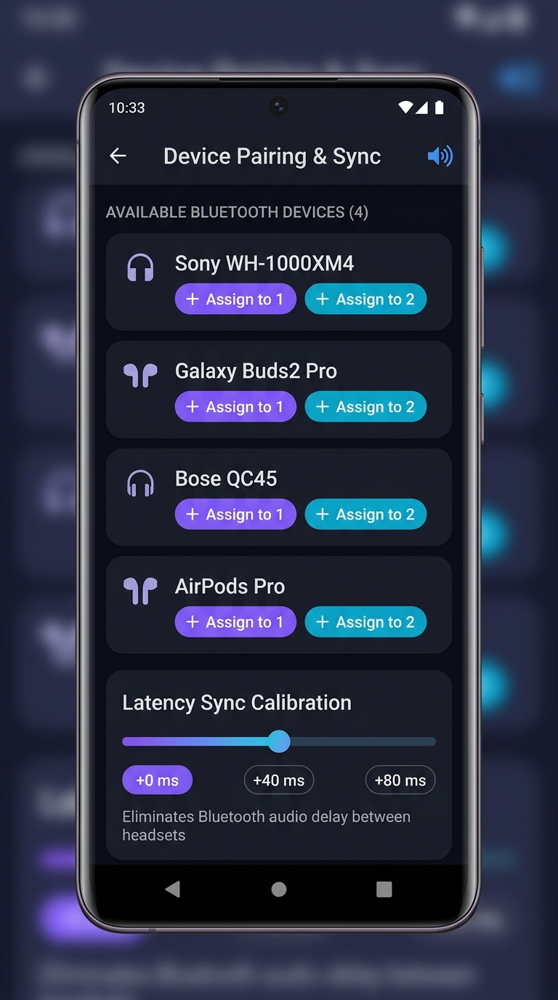
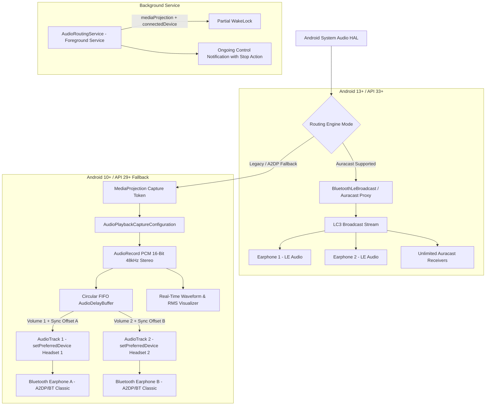

# 🎧 DualCast Audio (OSDualAudio)

<div align="center">

-brightgreen?logo=android&logoColor=white)


**Stream Android internal audio to two connected Bluetooth earphones at the exact same time.**  
Featuring **Bluetooth LE Audio / Auracast** (Android 13+) and a **Dual PCM AudioTrack engine** with **Latency Sync Calibration** (Android 10+).

[📥 Download Pre-built APK](#-download--install-apk-on-your-phone) • [✨ Features](#-key-features) • [📱 App Screenshots](#-app-screenshots) • [🛠️ Architecture](#️-technical-architecture) • [🚀 How to Use](#-quick-start-guide)

</div>

---

## 📱 App Screenshots

<div align="center">
  <table>
    <tr>
      <td align="center"><b>Live Audio Dashboard & Per-Earphone Sliders</b></td>
      <td align="center"><b>Bluetooth Device Manager & Latency Sync Calibration</b></td>
    </tr>
    <tr>
      <td></td>
      <td></td>
    </tr>
  </table>
</div>

---

## ✨ Key Features

* 📡 **Simultaneous Dual Audio Output**: Play music, YouTube, Netflix, podcasts, or game audio into **two Bluetooth earphones at the same time**.
* 📻 **Primary Route: Bluetooth LE Audio / Auracast (API 33+)**:
  * Utilizes `BluetoothLeBroadcast` (Profile 26) to broadcast high-fidelity LC3 audio to unlimited Auracast receivers.
  * Auto-detects chipset broadcast capabilities with zero battery penalty.
* 🔄 **Secondary Route: System Audio Capture & Dual PCM Engine (API 29+)**:
  * Uses `MediaProjection` and `AudioPlaybackCaptureConfiguration` to capture all system-wide audio at the HAL/OS layer.
  * Splits stereo 16-bit 48kHz PCM into **two parallel `AudioTrack` instances** running at `URGENT_AUDIO` priority.
  * Routes each audio track directly to distinct Bluetooth MAC addresses using `AudioTrack.setPreferredDevice(AudioDeviceInfo)`.
* ⏱️ **Latency Sync Offset Calibration (Lip-Sync Lag Fix)**:
  * Different Bluetooth earphone models have different internal decoding latencies (e.g. Earphones A have 120ms delay, Earphones B have 220ms delay).
  * Built-in **circular FIFO ring buffer (`AudioDelayBuffer`)** allows introducing millisecond delay (0ms to 400ms) with fine-tuning (+/-10ms) to ensure both listeners hear sound in perfect lockstep.
* 🎚️ **Independent Software Volume & Mute Controls**:
  * Individual volume scaling sliders (0% to 120%) with saturation clipping prevention (`PcmProcessor.applyVolume`), independent of Android's master hardware buttons.
* 🔋 **Uninterrupted Background Foreground Service**:
  * Certified for **Android 14 (API 34) & Android 15 (API 35)** foreground service types (`mediaProjection | connectedDevice`).
  * Holds a `PARTIAL_WAKE_LOCK` to keep streaming alive when the screen is turned off or locked.
* 📊 **Live Audio Spectrum Visualizer**:
  * Real-time animated VU meter and EQ frequency bars responding to live audio amplitude.

---

## 📥 Download & Install APK on Your Phone

The pre-compiled debug APK is included directly in this repository!

### 🔗 Direct APK Download Link:
👉 [**Download DualCast-Audio.apk**](https://raw.githubusercontent.com/Akshat-hub7/OSDualAudio/main/DualCast-Audio.apk) *(or download `DualCast-Audio.apk` from the root of this repo)*

---

### 📲 4 Simple Ways to Transfer the APK to Your Phone

#### Method 1: Download Directly on Your Phone (Easiest)
1. Open Chrome on your phone.
2. Go to `https://github.com/Akshat-hub7/OSDualAudio`.
3. Tap on `DualCast-Audio.apk` and tap **View Raw** or **Download**.

#### Method 2: Send via WhatsApp / Telegram / Discord
1. On your PC, open WhatsApp Web or Telegram.
2. Send `DualCast-Audio.apk` to your own number or "Saved Messages".
3. Open WhatsApp/Telegram on your phone, tap the file, and tap **Install**.

#### Method 3: USB Cable / ADB
* **File Transfer**: Connect phone via USB cable -> Choose **File Transfer** mode -> Copy `DualCast-Audio.apk` into your phone's **Downloads** folder.
* **ADB Command Line**:
  ```bash
  adb install -r DualCast-Audio.apk
  ```

#### Method 4: Local Wi-Fi Web Server (No Cables Needed)
1. On your PC, open PowerShell inside this project folder and run:
   ```powershell
   python -m http.server 8080
   ```
2. Find your PC IP address using `ipconfig` (e.g. `192.168.1.10`).
3. Open your phone's browser and go to `http://192.168.1.10:8080/DualCast-Audio.apk`.

---

### ⚙️ How to Install on Android

1. Tap on the downloaded `DualCast-Audio.apk` file.
2. If Android prompts: *"For your security, your phone is not allowed to install unknown apps from this source"*:
   * Tap **Settings**.
   * Turn the toggle **Allow from this source** to **ON**.
   * Go back and tap **Install**.
3. Tap **Open**.

---

## 🚀 Quick Start Guide

### Step 1: Pair Both Earphones in Android Settings
1. Put both sets of Bluetooth earphones into pairing mode.
2. Open Android **Settings -> Connected devices -> Bluetooth**.
3. Connect **Earphone 1** and **Earphone 2** so both appear as connected audio devices.

### Step 2: Open DualCast Audio & Grant Permissions
* **Nearby devices / Bluetooth**: Detects bonded and connected earphones.
* **Record Audio**: Required for internal system audio capture (`AudioPlaybackCapture`).
* **Notifications**: Required to keep the audio pipeline active with the screen off.

### Step 3: Assign Headset Slots
1. Tap **HEADSET 1 (SLOT A)** and choose your first earphone model.
2. Tap **HEADSET 2 (SLOT B)** and choose your second earphone model.

### Step 4: Start Streaming
1. Tap **START DUAL STREAMING**.
2. When Android displays: *"DualCast will have access to all audio"*, tap **Start now**.
3. Start playing music, a video, or a movie on Spotify, YouTube, or Netflix.
4. **Enjoy shared audio on both headsets simultaneously!**

### Step 5: Adjust Volume & Eliminate Latency Lag
* Adjust each listener's volume slider to their preferred level.
* If one earphone sounds slightly behind the other due to Bluetooth codec latency differences, drag the **Latency Sync Offset** slider on the faster earphone (+10ms to +400ms) until both ears hear the audio in exact synchronization!

---

## 🛠️ Technical Architecture



### Technical Specs:
| Component | Implementation |
|---|---|
| **Audio Format** | PCM 16-bit Stereo (`ENCODING_PCM_16BIT`, `CHANNEL_OUT_STEREO`) |
| **Sample Rate** | 48,000 Hz (Low-latency native Android mixer rate) |
| **Buffer Strategy** | Double min-buffer allocation with atomic circular ring delay line |
| **Worker Thread** | `Process.setThreadPriority(THREAD_PRIORITY_URGENT_AUDIO)` |
| **Foreground Type** | `FOREGROUND_SERVICE_TYPE_MEDIA_PROJECTION \| FOREGROUND_SERVICE_TYPE_CONNECTED_DEVICE` |
| **Min SDK** | Android 10 (API 29) |
| **Target SDK** | Android 14 / 15 (API 34 / 35) |

---

## 📂 Project Directory Structure

```
OSDualAudio/
├── .github/workflows/
│   └── build-apk.yml               # Automated GitHub Actions APK build & release
├── docs/
│   └── screenshots/                # Application mockups and visual documentation
│       ├── dashboard_mockup.png
│       └── devices_mockup.png
├── app/
│   ├── build.gradle.kts            # App module build configuration
│   ├── proguard-rules.pro          # ProGuard rules
│   └── src/main/
│       ├── AndroidManifest.xml     # Permissions & Foreground Service declarations
│       ├── java/com/dualaudio/streamer/
│       │   ├── DualAudioApp.kt     # Application class & Notification Channels
│       │   ├── MainActivity.kt     # Permission flows & MediaProjection launcher
│       │   ├── audio/
│       │   │   ├── AudioCaptureEngine.kt     # System audio capture & dual AudioTracks
│       │   │   ├── AudioDelayBuffer.kt       # Circular FIFO sync offset buffer
│       │   │   ├── AudioDeviceInfoHelper.kt  # Bluetooth audio device resolver
│       │   │   └── PcmProcessor.kt           # Volume attenuation & RMS metering
│       │   ├── bluetooth/
│       │   │   ├── BluetoothDeviceManager.kt # A2DP, Headset, and LE profile manager
│       │   │   └── LeBroadcastManager.kt     # Android 13+ Auracast broadcast engine
│       │   ├── data/
│       │   │   ├── BluetoothDeviceModel.kt   # Device models & enum states
│       │   │   └── RoutingConfig.kt          # Volume, delay & routing payload
│       │   ├── service/
│       │   │   ├── AudioRoutingService.kt    # Foreground service with WakeLock
│       │   │   └── NotificationHelper.kt     # Ongoing foreground notification
│       │   ├── ui/
│       │   │   ├── DualAudioUiState.kt       # Compose state holder
│       │   │   ├── DualAudioViewModel.kt     # UI coordinator & service binder
│       │   │   ├── MainScreen.kt             # Jetpack Compose UI layout
│       │   │   ├── components/               # Custom UI cards, sliders & visualizer
│       │   │   └── theme/                    # Material 3 dark theme styling
│       │   └── util/
│       │       └── PermissionHelper.kt       # API-dependent runtime permissions
│       └── res/                              # Drawables, icons, and strings
├── DualCast-Audio.apk              # Pre-compiled ready-to-run APK
├── build.gradle.kts                # Root project build script
├── settings.gradle.kts             # Gradle settings
└── README.md
```

---

## 💻 Building from Source

If you want to build or modify the app yourself:

```bash
# Clone the repository
git clone https://github.com/Akshat-hub7/OSDualAudio.git
cd OSDualAudio

# Build debug APK on Windows:
.\gradlew.bat assembleDebug

# Build debug APK on Linux/macOS:
chmod +x gradlew
./gradlew assembleDebug
```

The APK will be generated at `app/build/outputs/apk/debug/app-debug.apk`.

---

## ❓ Frequently Asked Questions (FAQ)

<details>
<summary><b>Does this work on non-Samsung phones?</b></summary>
Yes! Samsung has a proprietary "Dual Audio" feature exclusive to Galaxy devices running One UI. <b>DualCast Audio</b> works on <b>all Android devices (Pixel, OnePlus, Motorola, Xiaomi, Sony, etc.)</b> running Android 10 or newer.
</details>

<details>
<summary><b>Why does the audio sound delayed in one earphone?</b></summary>
Different Bluetooth earphones use different decoders and hardware buffers (e.g. Earphone A uses SBC with 150ms delay, Earphone B uses AAC with 250ms delay). Simply move the <b>Latency Sync Offset</b> slider on the faster earphone until both ears match up perfectly.
</details>

<details>
<summary><b>Does the audio keep playing when my phone screen is turned off?</b></summary>
Yes. DualCast runs inside an Android Foreground Service with an active CPU <code>WakeLock</code> and persistent notification, ensuring Android does not kill the stream during screen lock.
</details>

---

## 📄 License

```
Copyright 2026 Akshat Choudhary

Licensed under the Apache License, Version 2.0 (the "License");
you may not use this file except in compliance with the License.
You may obtain a copy of the License at

    http://www.apache.org/licenses/LICENSE-2.0

Unless required by applicable law or agreed to in writing, software
distributed under the License is distributed on an "AS IS" BASIS,
WITHOUT WARRANTIES OR CONDITIONS OF ANY KIND, either express or implied.
See the License for the specific language governing permissions and
limitations under the License.
```
